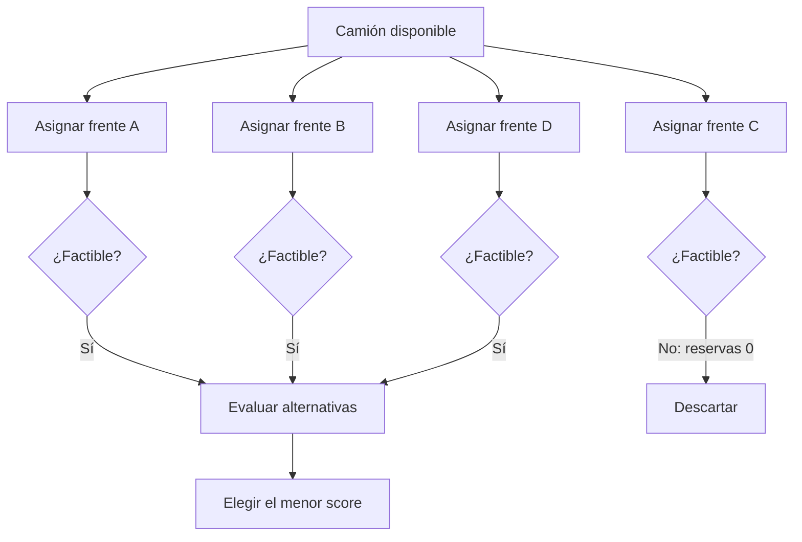

# Actividad 2 — Espacio de estados (5 puntos)

**Estado inicial:** `camion_disponible`, sin destino asignado.

**Estados sucesores:** `asignado_A`, `asignado_B`, `asignado_C`, `asignado_D`.

**Operadores:** `asignar(A)`, `asignar(B)`, `asignar(C)`, `asignar(D)`.

**Restricciones:** `reservas_ton > 0`, `acceso_vial == 1` y `carga_planificada_ton <= capacidad_camion_ton` (además, la carga debe ser menor o igual a las reservas). Para demostración se utiliza un camión hipotético de 150 t y carga planificada de 120 t; **estas capacidades no provienen del caso original**.

**Estado meta:** un destino factible que optimice una puntuación de decisión; no implica que el camión transporte todas las reservas del frente.

**Función multicriterio original del caso:** `score = distancia_km - reservas_ton/1000 - ley_cobre_pct*10`; elegir el menor score. Los factores de escala son arbitrarios y solo didácticos, no equivalen literalmente a toneladas útiles por km.

**Modelo gráfico:** consultar `images/espacio_estados.png` (generado por el notebook) o diagrama Mermaid:

